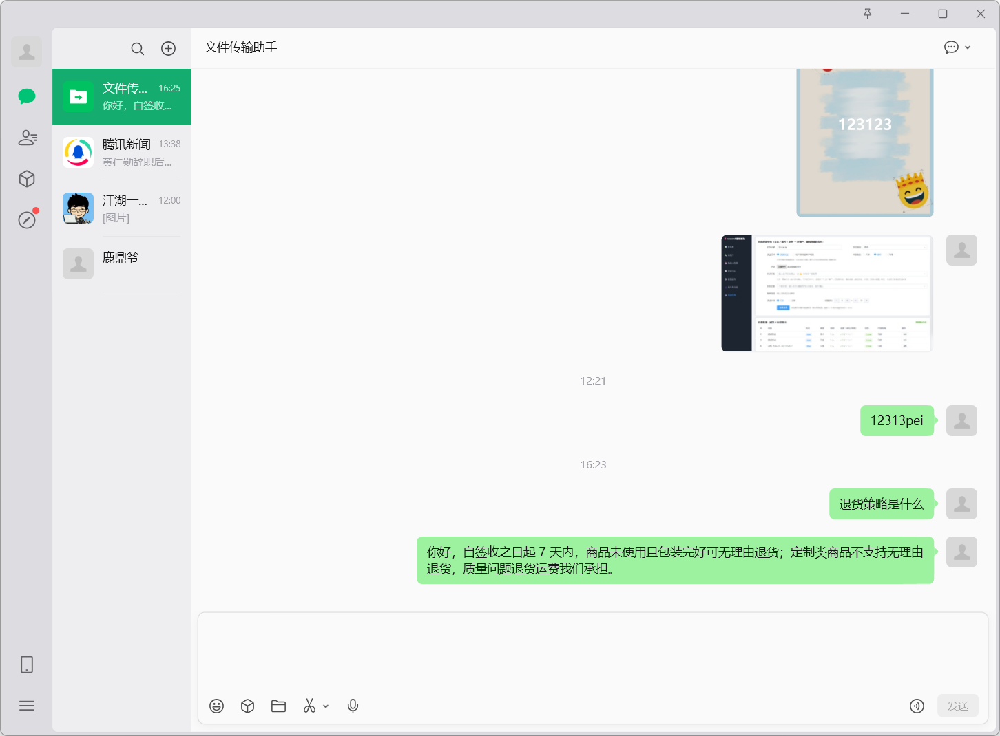
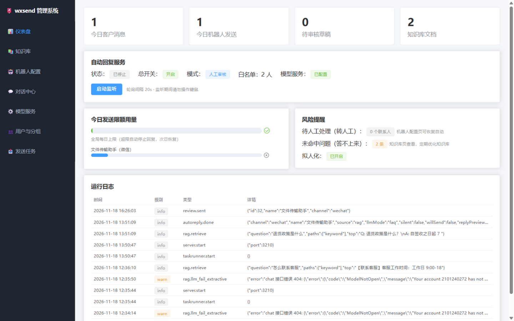
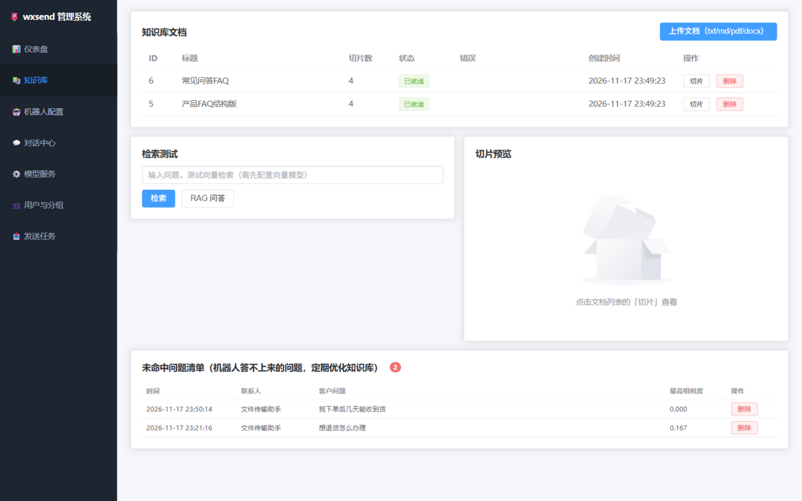
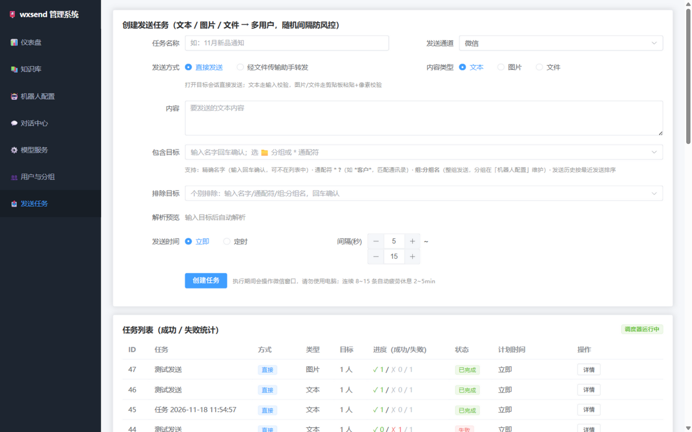
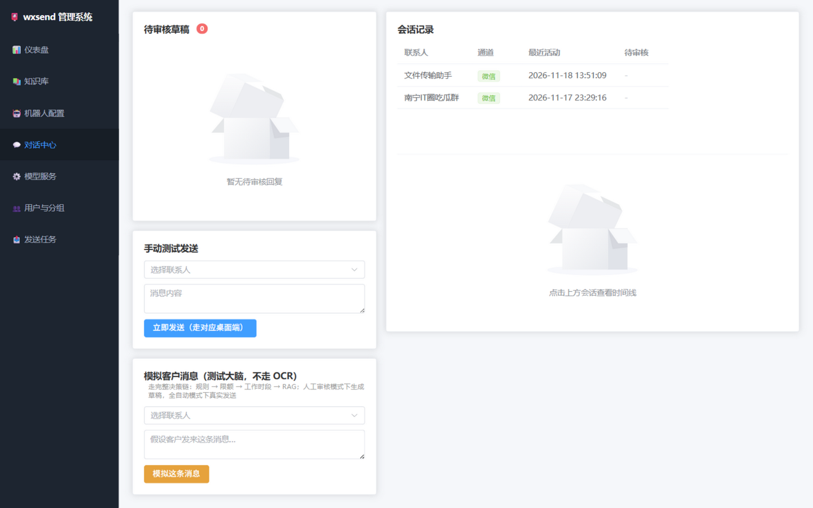
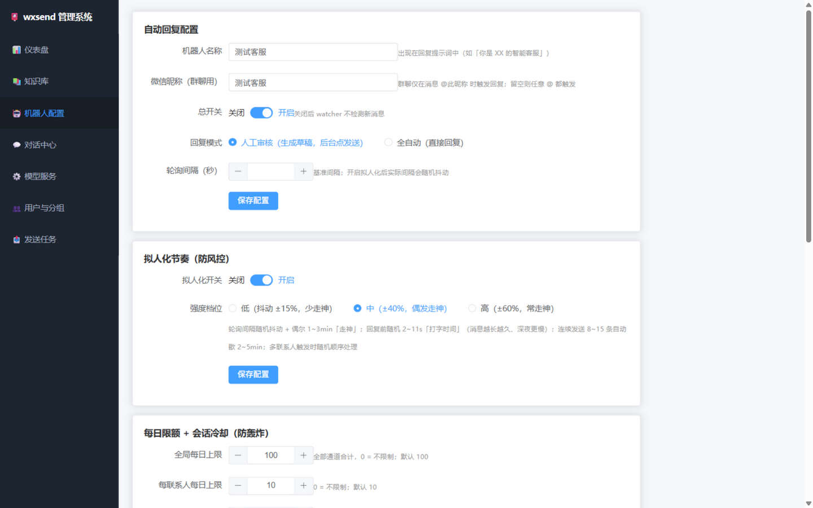

# wxsend — 微信智能客服 & 自动化营销工作台

> 让微信私域客服 7×24 小时自动营业：**知识库问答 · 未读自动回复 · 批量群发 · 拟人化防风控**，全程「截图 → OCR 识别 → 视觉验证」闭环，不注入、不逆向、不碰协议，用你现有的微信桌面端就能跑。

<p align="center">
  
</p>
<p align="center"><i>实拍：客户咨询退货政策，机器人基于知识库自动生成专业回复（含措辞随机化，每次答复不完全一样）</i></p>

***

## ✨ 它能做什么

| 能力                   | 说明                                                                              |
| -------------------- | ------------------------------------------------------------------------------- |
| 🧠 **RAG 知识库问答**     | 上传 txt/md/pdf/docx/FAQ 问答对 → 自动切片入库 → 客户提问时检索知识库生成专业回复；支持 FAQ 高相似直答（毫秒级、不耗 LLM） |
| 👀 **未读消息自动识别**      | 后台轮询截图 + OCR 识别会话列表，白名单联系人一有新消息立即打开会话读取并回复                                      |
| 💬 **全自动 / 人工审核双模式** | 全自动模式直接回复客户；审核模式生成草稿，人工一键确认发送，渐进式上线                                             |
| 📤 **批量群发 & 定时任务**   | 文本/图片/文件，目标支持精确名单、通配符（`*客户*`）、分组（`组:VIP`）；随机限速 + 顺序洗牌 + 连续疲劳休息                  |
| 🔁 **转发分发**          | 把文件传输助手里的一条消息（文字/图片/文件均可）一次转发勾选多个接收人                                            |
| 🛡️ **五层安全风控**       | 白名单 → 转人工关键词 → 每小时/每日限额 → 工作时段 → 每步 OCR 视觉验证（定位失败即中止，绝不盲发）                      |
| 🕵️ **拟人化引擎**        | 轮询间隔抖动、随机「走神」、打字延迟、回复措辞抖动、深夜减速、疲劳休息——行为更像真人                                     |
| 🖥 **桌面端一键安装**       | 安装包内置全部运行时，客户机**无需安装 Node.js**，装完即用                                             |

***

## 📸 系统界面

<p align="center">
  <b>仪表盘 —— 自动回复服务状态 / 发送限额 / 风险提醒 / 运行日志</b><br>
  
</p>

<p align="center">
  <b>知识库 —— 文档上传 / 切片检索测试 / 答不上来的问题自动收集，定期优化话术</b><br>
  
</p>

<p align="center">
  <b>发送任务 —— 文本/图片/文件批量群发，随机间隔拟人化执行，逐目标成功/失败统计</b><br>
  
</p>

<p align="center">
  <b>对话中心 —— 待审核草稿一键发送 / 会话时间线 / 手动测试发送 / 模拟客户消息测试机器人</b><br>
  
</p>

<p align="center">
  <b>机器人配置 —— 回复模式 / 拟人化节奏（抖动·走神·打字延迟·疲劳休息）/ 多层限额防轰炸</b><br>
  
</p>

***

## ⚙️ 工作原理

```
轮询截图会话列表（OCR）→ 白名单联系人预览变化 = 有新消息
  → 打开对应会话 → OCR 识别最新客户消息 → 去重
  → 决策链：转人工关键词 → 限额 → 工作时段 → 确定性规则 → RAG 检索生成
  → 回复抖动 + 打字延迟 + 疲劳休息
  → 全自动：直接发送 / 审核模式：存草稿等人工确认
```

全程基于 **截图 + OCR + 定向键鼠 + 视觉验证**，每一步都确认界面状态后才执行下一步，任何一环验证失败立即中止——这是与「协议破解型」机器人本质区别，账号风险最低的方案。

- 支持任意 **OpenAI 兼容**大模型服务（智谱 / DeepSeek / 通义 / Kimi / 火山方舟…），页面上填地址和 Key 即可切换
- FAQ 问答对高相似命中时**直接返回答案，不消耗 LLM**
- LLM 临时不可用时自动降级为知识库原文回复，服务不中断

## 🖥 部署方式

| 方式             | 说明                                                    |
| -------------- | ----------------------------------------------------- |
| **桌面端安装包**（推荐） | 双击安装，内置全部运行时，零环境依赖                                    |
| 源码运行           | 需 Node.js ≥ 18 与微信桌面端，`npm install && npm run server` |

- 支持 **Windows**（已实机验证）与 **macOS**
- 电脑需保持登录微信/企业微信桌面端；自动化执行期间请勿操作键鼠

## 🎯 适用场景

- 私域电商客服：售前咨询、售后政策自动答疑（退货/发货/会员规则）
- 社群运营：群消息 @机器人 问答、定时通知群发
- 门店/本地生意：活动通知批量触达、客户回访
- 任何「微信上被反复问同样问题」的生意

## 🛠 定制服务

系统按你的业务深度定制，欢迎联系（**QQ / 微信同号**）：467643531

可定制方向：

- 接入你的私有知识库 / 业务系统 / 订单数据库
- 多账号矩阵、多员工协同、私有化部署
- 界面品牌化（换 Logo / 名称 / 配色）
- 对接企业微信、公众号等其他渠道
- 按行业定制话术策略与风控参数

## 📄 版权与授权

Copyright © 2026. 保留所有权利（All Rights Reserved）。

本仓库仅用于产品介绍，不包含源码。本软件（含源码、安装包与授权体系）受版权保护，未经作者书面授权，禁止复制、分发、逆向工程或商业使用。

商业部署 / 源码定制 / 私有化交付，请联系：**QQ / 微信同号 467643531**
